<div align="center">

# 🧭 geo-sleuth

**写真が撮影された場所を突き止め、その過程も示すエージェントスキルです。**

<p align="center">
  <a href="README.md"></a>
  <a href="README.zh-CN.md"></a>
  <a href="README.ja.md"></a>
</p>

<p align="center">
  <a href="LICENSE"></a>
  <a href="https://www.python.org/downloads/"></a>
  <a href="https://agentskills.io"></a>
  <a href="CONTRIBUTING.md"></a>
  <a href="https://github.com/Oldcircle/geo-sleuth/stargazers"></a>
</p>

<p align="center">
  <b>対応エージェント</b><br>
  <a href="https://code.claude.com/docs/en/skills"></a>
  <a href="https://developers.openai.com/codex/skills"></a>
  <a href="https://cursor.com/docs/skills"></a>
  <a href="https://geminicli.com/docs/cli/skills/"></a>
  <a href="https://opencode.ai/docs/skills/"></a>
  <a href="https://docs.github.com/en/copilot/concepts/agents/about-agent-skills"></a>
  <br><sub>…そのほか、<code>SKILL.md</code> を読み込み、シェルコマンドを実行できるあらゆるエージェントで動作します。</sub>
</p>

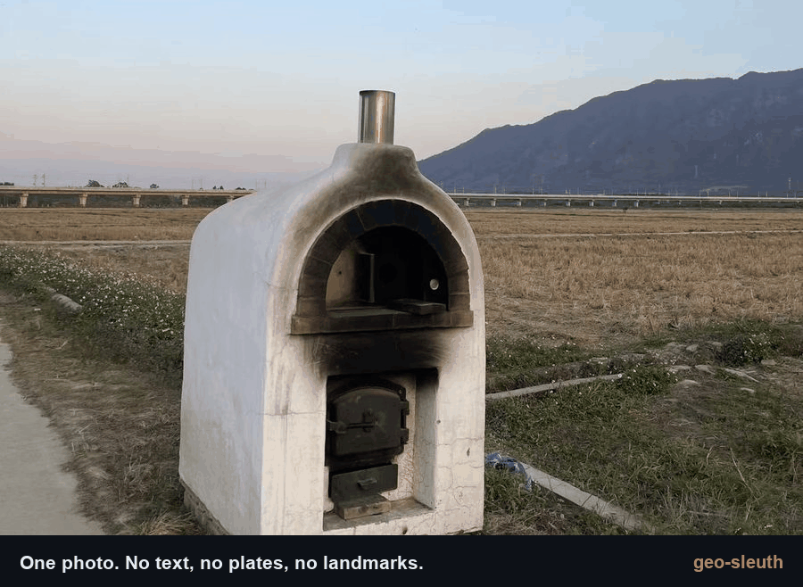

*文字なし。ナンバープレートなし。ランドマークなし。橋が 1 本、山が 1 つ。誤差 2 m 以内で位置を特定しました。*

</div>

---

## クイックスタート

```bash
npx skills add Oldcircle/geo-sleuth
```

プロンプトが表示されたら、使用するエージェントを選んでください。あとはエージェントに写真を渡して、次のように伝えます。

> find where this photo was taken

初回利用時は、インストールしたスキルの `scripts/` フォルダーにある `doctor.py` をエージェントに実行させ、失敗したチェックがあれば対処してください（[必要環境とセットアップ](#必要環境とセットアップ)を参照）。操作はこれだけです。エージェントは `SKILL.md` を読み、スクリプトを実行し、カメラの位置、カメラが向いていた方角、そして衛星画像の証拠画像を返します。フォルダーを自分でコピーしたい場合は、[インストール](#インストール)をご覧ください。

## geo-sleuth を選ぶ理由

- **写真 1 枚、一文だけ。** エージェントに写真を渡し、*find where this photo was taken* と伝えるだけです。カメラの位置、カメラが向いていた方角、衛星画像の証拠画像が返ってきます。
- **読み取れるものが何もなくても動作します。** 看板もナンバープレートもランドマークもなくても、OpenStreetMap のジオメトリ、標高データ、衛星タイル、ストリートビューだけで探索を進めます。
- **推測ではなく幾何学で。** 橋脚の間隔は距離の物差しに、影は方位に、稜線は標高データと照合できる指紋になります。
- **すべての主張はファイルを指し示します。** 結論には、セッション中に実行したコマンドと、それが生成したファイルを明記する必要があります。人口や知名度は証拠になりません。
- **スクリプトが順位付けし、モデルが判断します。** 単機能の 20 個のスクリプトが探索、スコアリング、並べ替えを行い、モデルは上位の数件から選ぶだけです。
- **1 つのスキルで、あらゆるエージェントに。** 標準的な Agent Skill（`SKILL.md` とプレーンな Python スクリプト）なので、同じフォルダーが Claude Code、Codex、Cursor、Gemini CLI、OpenCode、GitHub Copilot で動作します。
- **回答には誤差半径が付きます。** 座標 ± 半径、カメラの向き、証拠画像、段階評価された信頼度を返します。

## 事例

これらの写真にはいずれも GPS データがありませんでした。各事例では、スキルが写真から何を読み取り、どのように探索範囲を絞り込み、確認済みのカメラ位置から結果がどれだけ離れていたかを示しています。

各事例は、1 つのモデルによる 1 回の実行の記録です。スキルはエージェントに作業の進め方を示しますが、何を問い合わせ、どう絞り込み、上位何件を確認するかはモデル自身の判断です。そのため、別のモデルや異なる判断では同じ結果に至らない場合があります。各事例の下にある *再現条件とチェックポイント* には、入力、ヒント、主要なパラメーター、各段階でまだ候補に含まれているべきものを記載しているので、ご自身の実行がどのステップで分岐したかを特定できます。

<table>
<tr>
<td width="33%" align="center"><a href="#1-田んぼと高架橋">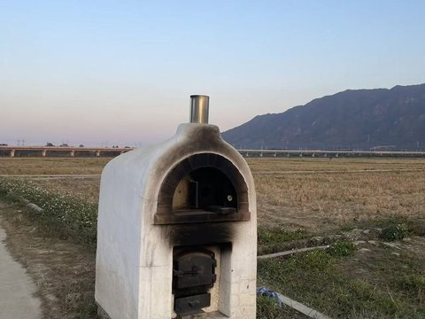</a></td>
<td width="33%" align="center"><a href="#2-1度ずれた砂漠のスカイライン">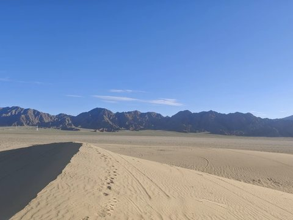</a></td>
<td width="33%" align="center"><a href="#3-バンクーバーの街路に咲く桜の木">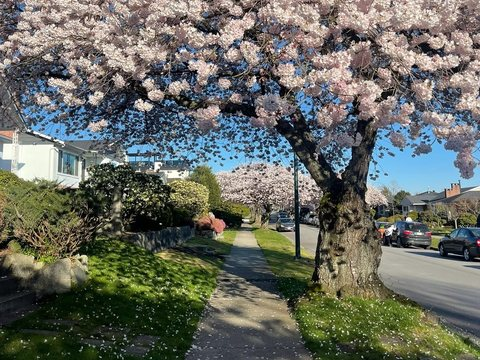</a></td>
</tr>
<tr>
<td><b>1 · 田んぼと高架橋</b><br><sub>鉄道橋 × スカイライン × 橋脚の数。</sub></td>
<td><b>2 · 砂漠のスカイライン</b><br><sub>送電線 × スカイライン × 1° 傾いたスマートフォン。</sub></td>
<td><b>3 · 桜の街路</b><br><sub>街路樹のオープンデータ × 影 × ストリートビュー。</sub></td>
</tr>
<tr>
<td align="center"><b>±2 m</b><br><sub>広東省清遠市</sub></td>
<td align="center"><b>100 m 以内</b><br><sub>青海省大柴旦</sub></td>
<td align="center"><b>3 m</b><br><sub>カナダ・バンクーバー</sub></td>
</tr>
</table>

### 1. 田んぼと高架橋

EXIF を削除したスマートフォンの写真です。稲刈りを終えた田んぼの端に白いかまどがあり、遠くに長い高架橋、右手に険しい山が写っています。画面内には文字が 1 つもありません。このスキルをインストールしたエージェントにメッセージを 1 通送るだけで、カメラの位置とカメラが向いていた方角が返ってきました。

**写真 → 27,335 → 171 → 14,372 → 22 → 3 → 1 → ±2 m**

| ステップ | 実施内容 | 残った候補 |
|---|---|---|
| **写真を読む** | 高架橋上の柱は架線柱なので、電化された鉄道です。橋脚の間隔を物差しとして使うと（スパン 32 m と*仮定*）、左側の区間は約 0.5 km、右側は 1 km 以上離れています。約 3 km 先に険しい山があります。稲は刈り取られているが草はまだ緑なので、まだ霜は降りていません。 | 華南（証明ではなく、あくまで賭け） |
| **地域スキャン** | OpenStreetMap からその地域のすべての鉄道橋を取得しました：**27,335 区間**。400 m ごとに地点をサンプリングし、各地点で標高データから 360° の地平線を計算しました。近くに平坦な地面があり、数 km 以内にはっきりした山があり、その隣の地平線が平らな地点を残しました。 | **171 地点** |
| **スカイラインの照合** | 各地点の周囲にカメラ位置の候補を配置し、それぞれから見える稜線を描画しました：**14,372 か所**。上位 20 件は互いに 0.1° 以内だったため、「橋は左側で近く、右側で遠い」という制約を追加しました。 | **22** |
| **重ね合わせによる確認** | 上位 3 件の稜線を写真に重ねて描きました。1 位（福州）は、かまどの陰に隠れた起伏があったためにスコアが高くなっていました。3 位（恵州）は写真では平らな部分で傾斜していました。2 位（清遠）は山の麓から画面の端まで一致しました。 | **1** |
| **橋脚の数** | 写真に写る 17 本の橋脚は、カメラからの 17 本の方位線になります。それらが線路と交わる点は等間隔でなければなりません。スカイラインと組み合わせると、まず長さ約 300 m の帯に、次に 1 地点に絞られました。 | **±2 m** |

<div align="center">
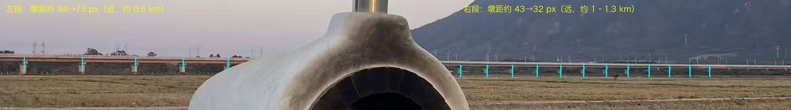<br>
<sub>物差しとしての橋脚：左側の広い間隔は近いことを、右側の狭い間隔は遠いことを意味します。</sub><br><br>
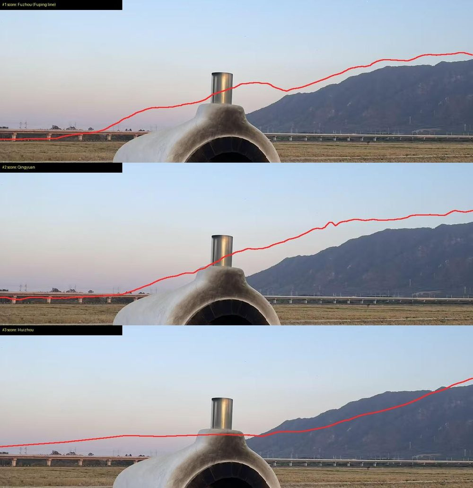 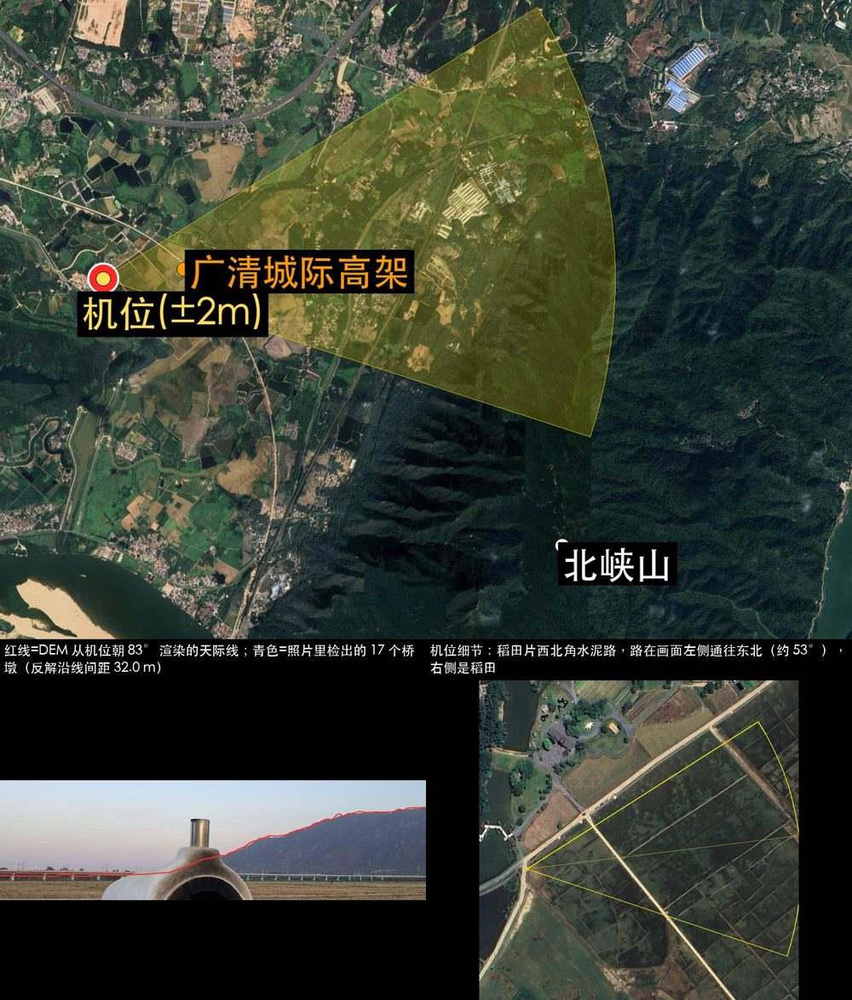<br>
<sub>左：上位 3 件の稜線を写真に重ねたもの。右：スキルが生成した証拠画像。</sub>
</div>

<details>
<summary>この実行のその他の図</summary>
<br>
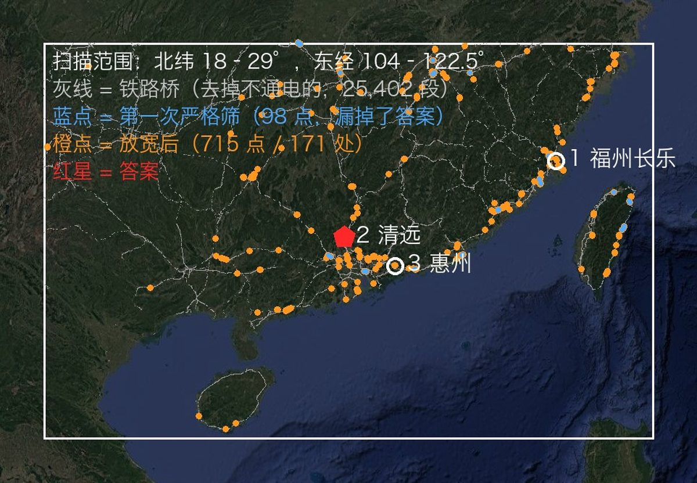<br>
<sub>地域スキャン：地域内のすべての鉄道橋（灰色）と、地平線テストを通過した地点（オレンジ）。</sub><br><br>
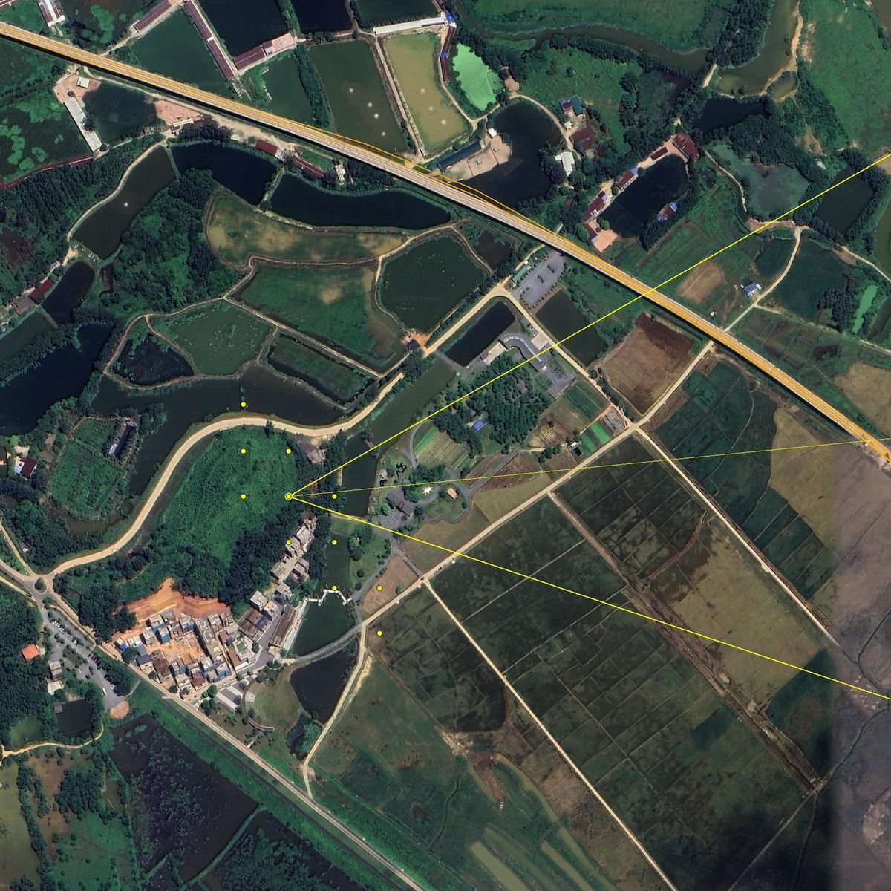<br>
<sub>橋脚の数：17 本の橋脚への方位線が線路と交わります。間隔が等しくなるカメラ位置は 1 つしかありません。</sub><br><br>
<sub>実行には全体で約 72 分かかり、そのおよそ半分は計算待ちでした。</sub>
</details>

<details>
<summary>再現条件とチェックポイント</summary>
<br>

- **この記録について**：表は、この手法がこの写真を初めて解いたときのもの（Claude Opus 5.0）で、ブラインド再実行ではありません。そのステップは後にスキルに組み込まれました。
- **入力**：EXIF を削除した 1280×1707 のスマートフォン写真。この README の画像は表示用で、入力には適していません。
- **候補**：地域内にある OSM の鉄道橋 27,335 区間すべて。除外したのは `electrified=no` のタグが付いたものだけで（当時の `rail_mtn_scan.py` と、現在の `terrain.py scan` のデフォルトと同じ）、`highspeed` による絞り込みは行っていません。架線柱からわかるのは路線が電化されていることだけです。正解の路線である広清城際鉄道は OSM 上に 55 の橋梁区間がありますが、`highspeed=yes` のタグが付いたものは 1 つもありません。
- **チェックポイント**：地平線テストを通過した 171 地点には、正解付近の都市間鉄道の橋梁区間が含まれているはずです。スカイラインの照合は 14,372 のカメラ位置を対象とし、上位 20 件は 0.1° 以内に収まり、「橋は左側で近く、右側で遠い」によって 22 件に絞られます。上位 3 件を重ね合わせ、17 本の橋脚の方位線で地点が確定します。
- **事例用スクリプト**：`examples/rail-skyline-session/` には、この写真向けに調整したスクリプトが入っています。OSM は 1 本の路線を同じ名前の多数の way に分割しています。`joint.py` は候補の中心付近にある同名の way を 1 つずつ順に試すため、結果はクエリが返す順序に依存しません。

</details>

### 2. 1度ずれた砂漠のスカイライン

手前に砂丘、その奥に草木のない暗い色の山並み、そして山並みの麓に鉄塔がいくつか写っています。画面内には文字も道路も建物もなく、画像の逆検索では中国北西部の一般的な砂漠の写真しか返ってきませんでした。

<div align="center">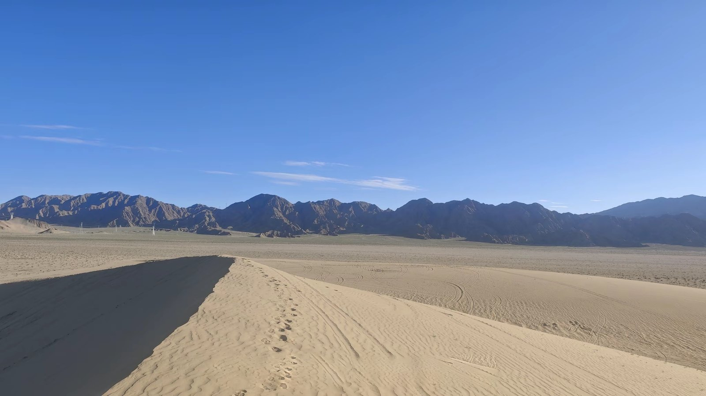</div>

**写真 → 1,537 地点 → 約 10 px で行き詰まり → 1° の傾きを解く → 1 地点 → 1 つの砂丘**

| ステップ | 実施内容 | 残り |
|---|---|---|
| **写真を読む** | 人工物は鉄塔だけなので、カメラは送電線から数 km 以内にあります。砂、砂利、むき出しの岩は中国北西部を示しています。 | 4 省 |
| **送電線 × 地形** | `osm.py geom` で新疆、甘粛、寧夏、青海のすべての送電線を取得しました。`terrain.py scan` が標高データを使ってそれらに沿って調べ、山が視界を占める場所を残しました。 | **1,537 地点** |
| **スカイラインの照合** | `terrain.py ridge` で写真の稜線をトレースし、`terrain.py fit` で各地点から見える稜線と比較しました。青海では上位 25 地点がすべて 9.6〜11.7 px の範囲に収まり、正解の地点は 9 位でした。 | **行き詰まり** |
| **傾き** | スマートフォンが水平から 1° ずれていると、2048 px の画面の端で稜線が 1024 × tan 1° ≈ 18 px、平均で約 10 px ずれます。これは地点間の差と同程度の大きさです。正解の地点では、画面全体の誤差が傾き tan θ（θ ≈ 1°）の直線上に並びます。そこで `fit` を変更し、地平線のオフセットとあわせてロールも解くようにしました。 | |
| **再照合** | ロールを解くと、正解の地点は 11.1 px から 6.2 px になりました。次点の地点は 9.4 px でした。 | **1 地点** |
| **衛星画像** | 視線方向 1 km 以内に、三日月形の砂丘が 3 つとテントのキャンプがあります。750/330/110 kV の送電線の束が東に 1〜2 km の位置を通っており、そのため鉄塔は写真の左側にしか写っていません。カメラはキャンプの西にある砂丘の頂上に立ち、205° を向いていました。 | **1 つの砂丘** |

<div align="center">
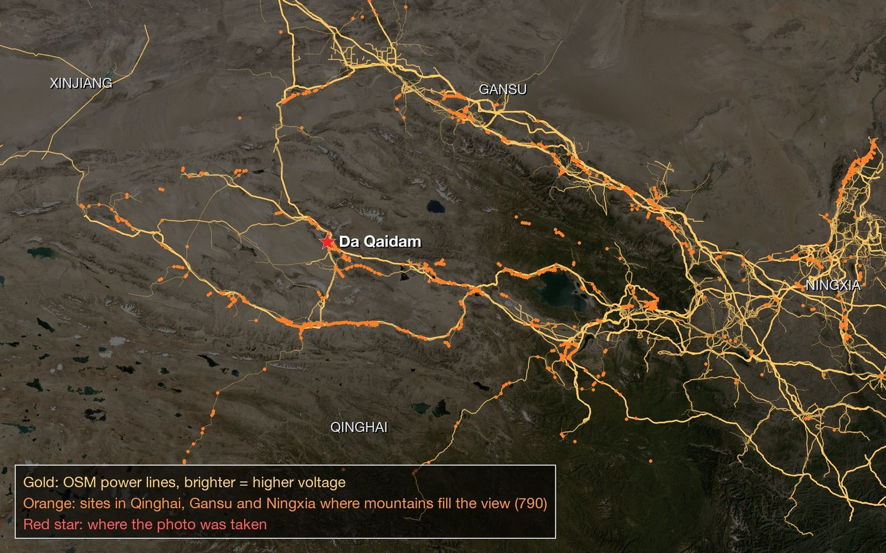<br>
<sub>OSM の送電線（金色）、山が視界を占める地点（オレンジ）、カメラ（赤い星）。新疆の地点は描画していません。</sub><br><br>
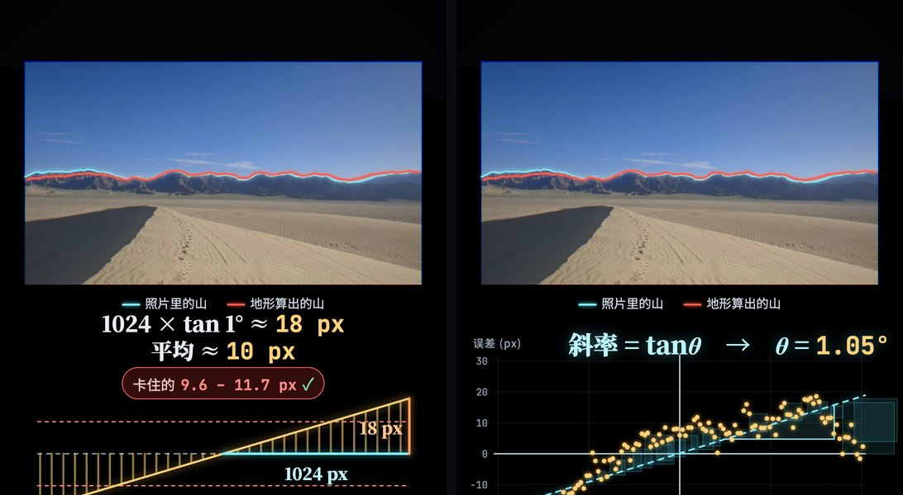<br>
<sub>ロールを解く前と後の正解の地点。上：誤差が画面の一方の端からもう一方へと大きくなり、その傾きから角度がわかります。下：ロールを解くと、その傾向は消えます。</sub><br><br>
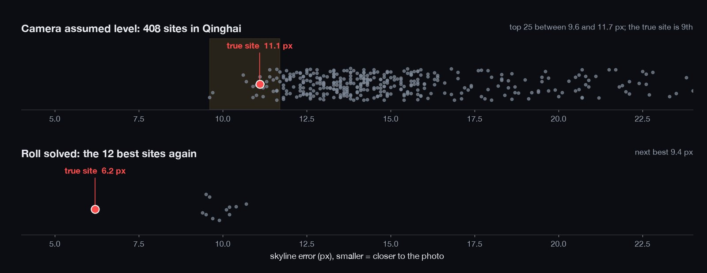<br>
<sub>地点ごとのスカイライン誤差。カメラが水平と仮定すると、正解の地点は集団の中に埋もれます。ロールを解くと、9 px を下回るのはその地点だけになります。</sub><br><br>
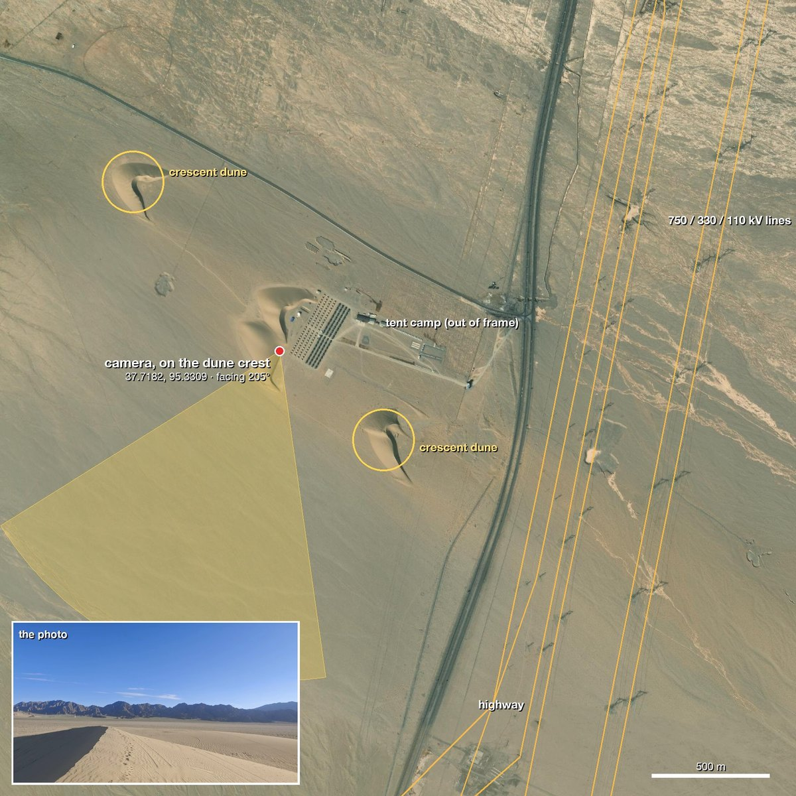<br>
<sub>証拠画像。OSM の送電線（金色）は、衛星画像に写る鉄塔の上を通っています。</sub>
</div>

**ブラインド再実行。** 後日、現在のスキルを使う新しいエージェントに、「中国にある」という 1 つのヒントだけを添えて写真を渡しました。エージェントは青海の 5,334 本の送電線をスキャンし、792 地点を照合して、次点の 0.357° に対して 0.224° の地点を選びました。32 分後、同じ砂丘の頂上にたどり着き、**確認済みのカメラ位置から 87 m** でした。この写真のために追加したロールの照合は、現在 `terrain.py fit` の一部になっています。この事例がコアスクリプトの変更の手本になっている理由は、[コントリビュート](#コントリビュート)で説明しています。

<details>
<summary>再現条件とチェックポイント</summary>
<br>

- **2 回の実行**：表は、ロールの照合につながった最初の解決（Claude Opus 5.0）です。ブラインド再実行はその後、Claude Opus 5.5 の新しいエージェントで行いました。
- **ブラインド実行の入力とヒント**：オリジナルの 2048×1152 の写真。ヒントは「中国にある」だけでした。この README の画像は表示用です。
- **ブラインド実行のチェックポイント**：青海の送電線 5,334 本。デフォルトの `--cluster-km 3.5` を使った `terrain.py scan` で 14,843 件のヒットが 792 クラスターになりました。792 件すべてを `terrain.py fit` にかけ（6 バッチ）、スカイライン照合の前に衛星画像の順位による足切りは行っていません。最良の地点は 0.224°、次点は 0.357° でした。その後、視線方向の衛星画像から砂丘とキャンプを見つけました。ツール呼び出し 87 回、32 分。
- **照合するクラスター**：`fit` は、各クラスターの代表点の周囲にのみカメラのグリッドを配置します。`--cluster-km` を大きくすると、代表点から遠いヒットは一度も照合されない可能性があります。現在の `scan` は各クラスターの広がり（`extent_m`）を記録し、クラスターが `--radius` より広い場合、`fit` は WARNING を出力します。
- **例**：`examples/desert-roll-fix/` は、固定した 12 地点でロール変更前後の照合を再現します（正解の地点は 12.0 px の 8 位から 6.2 px の 1 位へ）。

</details>

### 3. バンクーバーの街路に咲く桜の木

歩道の上で花を咲かせる桜の木です。ナンバープレートと街路設備から、バンクーバーであることがわかります。難しいのは通りを特定することで、この街には 1 万近くのブロックがあります。

**写真 → バンクーバー → 大きな桜 1,095 本 → 97 ブロック → 72 件の傾斜チェック → W 60th Ave → 3 m**

| ステップ | 実施内容 | 残り |
|---|---|---|
| **写真を読む** | 白と青の BC 州のナンバープレート、芝生の植え込み帯に立つ濃い緑の街灯、Vancouver Special の住宅。 | **バンクーバー** |
| **街路樹データ** | バンクーバー市は、すべての街路樹を樹種、幹の直径、住所付きで公開しています。候補は有名な桜並木からではなく、このデータから選びました。幹の直径が 40 cm 以上の花を咲かせる桜を抽出し、さらにそれが 3 本以上あるブロックに絞りました。 | **1,095 本、97 ブロック** |
| **影と傾斜** | 車の影は左側かつカメラ側に落ちているので、太陽は前方右側にあります。カメラ側の庭は石垣の奥で歩道より高い位置にあるので、通りのその側が上り側です。エージェントは標高データから 72 ブロックの横断勾配を測り、大きな木が通りのどちら側に立っているかを確認しました。 | **数ブロック** |
| **1 本ずつ確認** | W 60th Ave の 100 番台のブロックでは、北側に大きな桜が並んでいます。南側では、30〜60 m 先の木は直径 7.6 cm の若木で、次の大きな木は約 75 m 先にあります。写真も同じで、右手前には背の高いものがなく、遠くにピンク色の樹冠があります。 | **1 ブロック** |
| **ストリートビュー** | 2009 年と 2024 年の撮影画像には、石段のある石積みの擁壁、緑の街灯、白い家が写っています。屋上デッキのある家は 2024 年の画像と写真の両方に写っています。カメラは北側の歩道にあり、東を向いていました。 | **3 m** |

<div align="center">
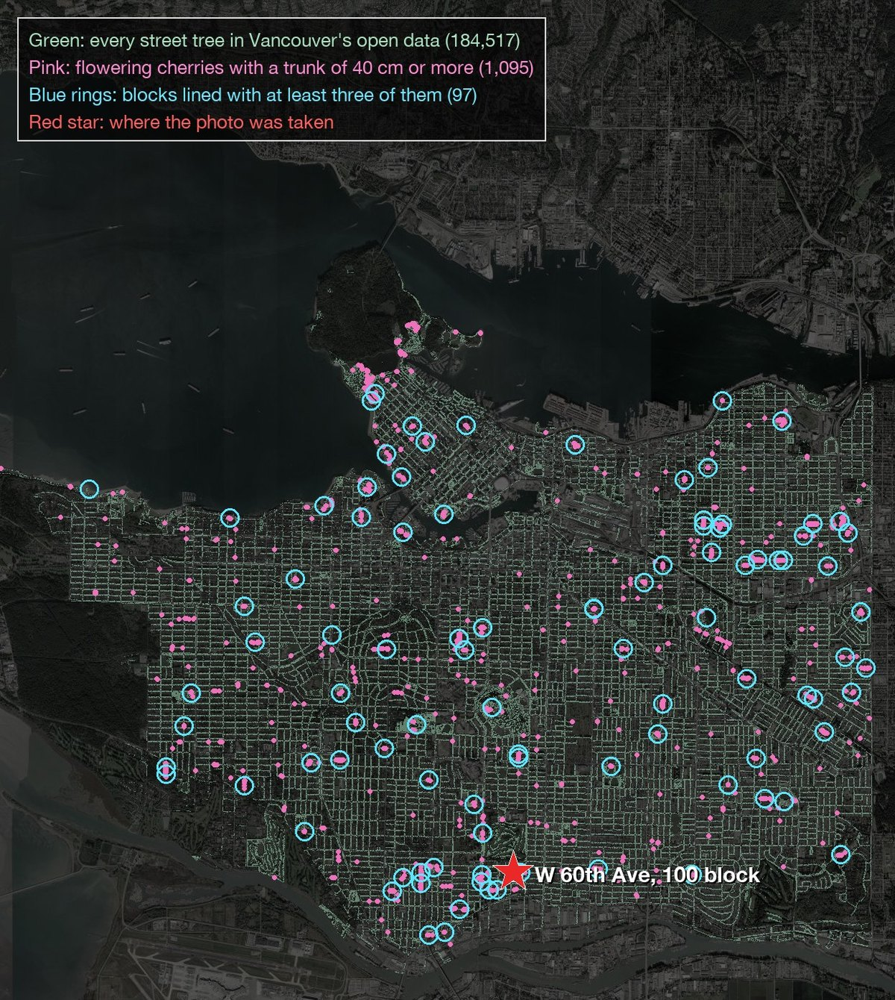 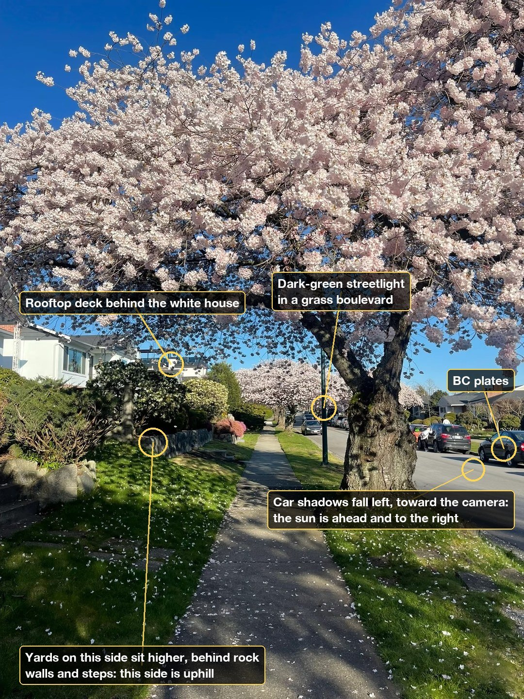<br>
<sub>左：市のデータにある座標付きの街路樹 184,517 本すべて、花を咲かせる大きな桜 1,095 本、候補の 97 ブロック。右：写真が明かしていること。</sub><br><br>
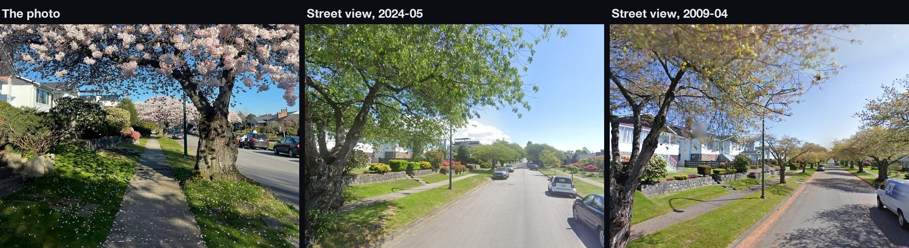<br>
<sub>写真は歩道から撮影され、ストリートビューの車は道路の中央を走行したため、角度が異なります。</sub><br><br>
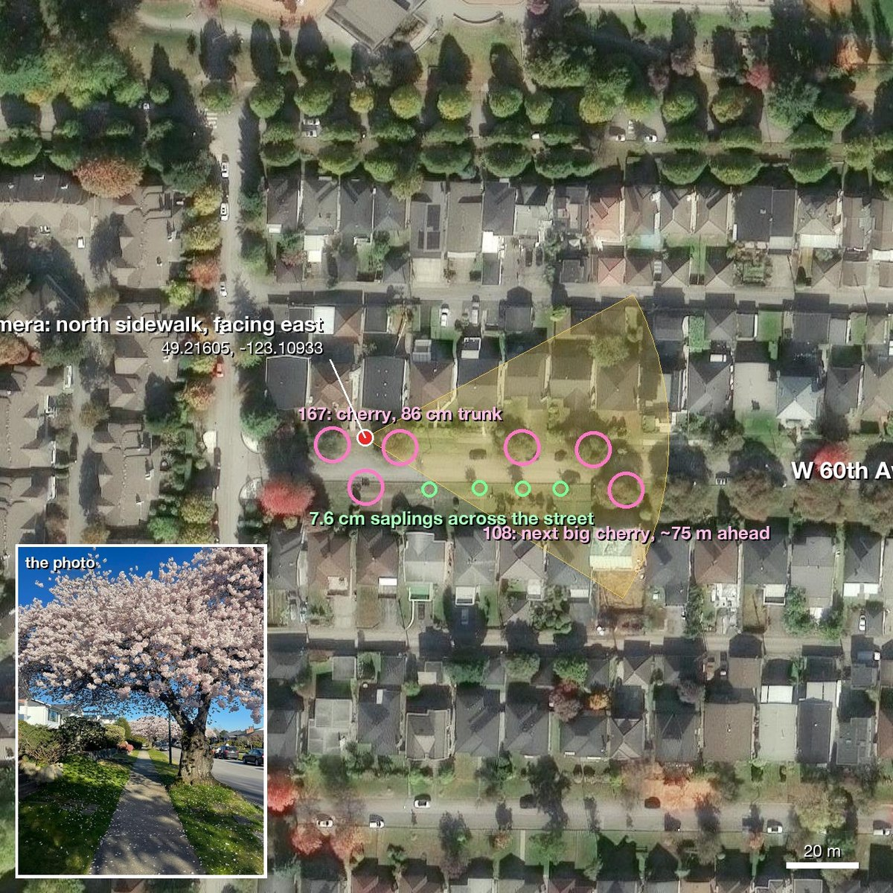<br>
<sub>証拠画像。ピンクの円は市のデータにある大きな桜、緑の円は若木です。</sub>
</div>

**ブラインド再実行。** 上の表はブラインド実行によるものです。現在のスキルを使う新しいエージェントに、ヒントなしで写真だけを渡しました。53 分で完了し、**確認済みのカメラ位置から 3 m** でした。

<details>
<summary>再現条件とチェックポイント</summary>
<br>

- **この記録について**：表はブラインド実行そのものです（Claude Opus 5.5、新しいエージェント、写真のみでヒントなし）。ツール呼び出し 154 回、53 分。
- **入力**：オリジナルの 1440×1920 の写真。この README の画像はトリミングした後、元のピクセル数の約 1/16 に縮小しているため、入力には適していません。
- **チェックポイント**：市のデータにある座標付きの街路樹 184,517 本 → 幹の直径 ≥ 40 cm の観賞用の桜 1,095 本 → それが 3 本以上ある街路区間 97 → 横断勾配を測定できた区間 72 → 大きな木が立つ側と傾斜の向きを照合した後に数区間が残ります。
- **ストリートビューでの確認**：画像全体での `match.py` の順位付けは良くありませんでした（満開の時期であり、写真は歩道から撮影されている一方、ストリートビューの車は道路の中央を走行していたため）。そのため、この実行では `--query-box 0,900,1440,1600` で木の領域だけを比較し、その後 2009 年と 2024 年のストリートビューで石垣、階段、街灯柱といった変化しない特徴を確認しました。正解の地点の SIFT インライアは 0〜5 しかありませんでしたが、それを理由に除外されることはありませんでした。`match.py` の出力で `inliers` が空（`refined: false`）の場合、その候補が精査されなかったことを意味し、一致が 0 件だったという意味ではありません。

</details>

## インストール

geo-sleuth は標準的な [Agent Skill](https://agentskills.io) です。`SKILL.md`、`scripts/`、`references/`、`data/` を含む 1 つのフォルダーで構成されています。[`skills`](https://github.com/vercel-labs/skills) CLI でインストールするか、フォルダーを自分でコピーしてください。

**6 つのエージェントすべてに、ユーザー全体で、1 つのコマンドで：**

```bash
npx skills add Oldcircle/geo-sleuth -g -a claude-code -a codex -a cursor -a gemini-cli -a opencode -a github-copilot -y
```

**手動で：**

```bash
git clone https://github.com/Oldcircle/geo-sleuth
mkdir -p ~/.agents/skills ~/.claude/skills
cp -r geo-sleuth/skills/geo-sleuth ~/.agents/skills/              # Codex, Cursor, Gemini CLI, OpenCode, GitHub Copilot
ln -s ~/.agents/skills/geo-sleuth ~/.claude/skills/geo-sleuth     # Claude Code
```

`~/.agents/skills/` は Codex、Cursor、Gemini CLI、OpenCode、GitHub Copilot が読み込むため、そこにコピーを 1 つ置けば 5 つすべてに対応できます。各エージェント独自のフォルダーは、それぞれのドキュメントによると次のとおりです。

| エージェント | ユーザー全体 | プロジェクト単位 |
|---|---|---|
| [Claude Code](https://code.claude.com/docs/en/skills) | `~/.claude/skills/` | `.claude/skills/` |
| [Codex](https://developers.openai.com/codex/skills) | `~/.agents/skills/` | `.agents/skills/` |
| [Cursor](https://cursor.com/docs/skills) | `~/.cursor/skills/` または `~/.agents/skills/` | `.cursor/skills/` または `.agents/skills/` |
| [Gemini CLI](https://geminicli.com/docs/cli/skills/) | `~/.gemini/skills/` または `~/.agents/skills/` | `.gemini/skills/` または `.agents/skills/` |
| [OpenCode](https://opencode.ai/docs/skills/) | `~/.config/opencode/skills/` または `~/.agents/skills/` | `.opencode/skills/` または `.agents/skills/` |
| [GitHub Copilot](https://docs.github.com/en/copilot/concepts/agents/about-agent-skills) | `~/.copilot/skills/` または `~/.agents/skills/` | `.github/skills/` または `.agents/skills/` |

`SKILL.md` を読み込み、シェルコマンドを実行できるその他のエージェントでも同じように動作します。そのエージェントがスキルを探す場所にフォルダーを置いてください。

## 仕組み

作業は 3 つのレイヤーに分かれています。スクリプトが決定し、スクリプトが知覚して順位付けし、モデルは上位の数件の中から判断するだけです。

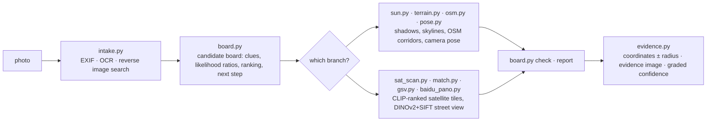

| レイヤー | 担当 | ツール |
|---|---|---|
| **決定**：どの候補を扱うか、証拠をどうスコアリングするか、何を除外できるか、次にどこをスキャンするか | スクリプト（候補ボード） | `board.py` |
| **知覚**：文字を読む、表を引く、衛星タイルから対象を見つける、ストリートビューを比較する | まずスクリプトが順位付けし、人が上位の数件を確認する | `intake.py` `ocr.py` `clues.py` `sat_scan.py` `match.py` `geo.py` |
| **判断**：画面から手がかりを引き出し、仮説を立て、順位付けされた数件から選ぶ | モデル | `SKILL.md` + `references/` |

すべての結論は、セッション中に実際に実行したコマンドと、それが生成したファイルを指し示す必要があります。除外には、読み取った証拠または計算した証拠が必要です。観察や推測は、候補の重みを下げることしかできません。

## ツールボックス

1 つの役割を持つスクリプトが 20 数個あります。データソースを含む完全な表は `skills/geo-sleuth/references/data-sources.md` にあります。

| 機能 | スクリプト |
|---|---|
| 環境チェック、ブラウザーの起動、任意のネットワーク疎通確認 | `doctor.py` |
| EXIF：GPS、撮影日時、換算焦点距離、方角 | `exif.py` |
| 画像全体、拡大した切り抜き、タイルに対する OCR（macOS では Apple Vision、それ以外では RapidOCR） | `ocr.py` |
| Baidu と Yandex での画像の逆検索。類似画像を番号付きのシートに並べる。キーワードによる画像検索 | `revimg.py` |
| ステップ 0〜3 を 1 つのコマンドで：メタデータ、端の切り抜き、バリエーション、OCR、逆検索 → `intake.md` | `intake.py` |
| 拡大切り抜き、端と隅の切り抜き、タイル分割、橋脚のような等間隔の構造物のピクセル列 | `imgprep.py` |
| 参照表：世界の国際電話番号、通行方向、属領。地域パックのナンバープレートの接頭辞、市外局番、行政区画 | `clues.py` + `data/` + `regions/` |
| 地域パック：一覧表示、国ごとのカードと手がかりの索引の表示、パックの lint | `regions.py` |
| 候補ボード：候補、手がかり、尤度比、除外、順位付け、スキャン順序、レポート前のチェック | `board.py` |
| 地名辞典：バウンディングボックス付きの下位区画の一覧、市街地の範囲 | `gazetteer.py` |
| 地名、団地名、店名 → 座標の候補。同名のものをすべて列挙 | `poi.py` |
| 太陽と影：緯度帯、時刻、通りの向き、日の当たる面からの方角、真方位 | `sun.py` |
| OSM Overpass：地物の共起、線から点、ルートの回廊、線の交点、街路網のテンプレート | `osm.py` |
| 衛星タイルのモザイク、マーカー、番号付きのサムネイルシート | `tiles.py` |
| 衛星グリッドのセルまたは候補地点の CLIP ゼロショットスコアリング（陸上トラック、工場、サイロ、ダムなど） | `sat_scan.py` |
| Baidu のパノラマとストリートビュー：地点、方角の描画、サムネイルシート、過去の撮影分の一括取得 | `baidu_pano.py` `gsv.py` |
| 候補となる地上画像を写真と照合して順位付け：DINOv2 による全体の類似度 + SIFT のインライア | `match.py` |
| 標高：合成した山の景観、スカイラインの重ね合わせ、断面図。線状地物 × 地形のスキャン、稜線の抽出、スカイラインの一括スコアリング | `terrain.py` |
| 複数点によるカメラ姿勢の推定：緯度・経度、高さ、方角、ピッチ、ロールと誤差半径 | `pose.py` |
| 方位、距離、視線の交点、整列線、フレーム・遮蔽のチェック、等間隔の構造物からのカメラ位置 | `geo.py` |
| 証拠画像：衛星タイル + カメラの扇形 + 比較グリッド | `evidence.py` |

事例 1 のステップ（地域スキャン、スカイラインの一括スコアリング、橋脚の間隔からのカメラ位置）は、サブコマンドとしてスキルに組み込まれています：`terrain.py scan / ridge / fit`、`imgprep.py piers`、`geo.py spacing`。その写真向けに調整した事例用スクリプトは `examples/rail-skyline-session/` に置いています。事例 2 の傾きは `terrain.py fit` 自体が解きます（`--roll-max`、デフォルトは 1°）。`examples/desert-roll-fix/` で変更前後を再現できます。

## ベンチマーク

オペレーターごとの計測結果：

| スクリプト | テスト | 結果 |
|---|---|---|
| `match.py` | 8 ケース：過去の Baidu パノラマを一括で写真として描画し、150 m 以内のパノラマを候補とする（深圳） | 正解の順位は 1/2/4/1/1 と 5/1/6 で、すべて上位 6 件以内、半数が 1 位 |
| `sat_scan.py` | 4×8 km、z17 で 364 セル、OSM でタグ付けされた陸上トラック 40 か所を正解とし、マルチスケール（深圳） | recall@20 17/40、@30 22/40、@100 32/40、順位の中央値 23 |
| `terrain.py scan / fit` + `geo.py spacing` | 上記の事例の写真で範囲を限定して再実行 | 正解のクラスターが 1 位、最終的な位置は正解から約 2 m |
| `terrain.py fit --roll-max` | 合成したスカイライン 8 ケース（方角、焦点距離はランダム、ロール ±1°） | 位置誤差の中央値 324 → 238 m（傾きなしのケース 324 → 89 m、傾きありのケース 1,695 → 265 m） |
| `terrain.py fit --roll-max` | 砂漠の事例の上位 12 地点 | 正解の地点が 12.0 px の 8 位 → 6.2 px の 1 位（次点 9.9 px） |
| `clues.py` | 6 つの表、9 つの値を抜き取り確認 | 9/9 正解 |

エンドツーエンドでは、写真（と記載のヒント）だけを持つ新しいエージェントによるブラインド再実行：

| 事例 | ヒント | 結果 | 時間 |
|---|---|---|---|
| [砂漠のスカイライン](#2-1度ずれた砂漠のスカイライン) | 「中国にある」 | 確認済みのカメラ位置から 87 m | 32 分 |
| [桜の街路](#3-バンクーバーの街路に咲く桜の木) | なし | 確認済みのカメラ位置から 3 m | 53 分 |

どちらの写真も以前に解かれており、そこから得た教訓がスキルに含まれているため、これらは未知の写真での精度ではなく、回帰チェックです。

この手法は、オンラインのジオロケーション系クリエイターによる 14 本の動画、22 問のパズル、そして一連の実際の実行を分析し、うまくいったものをルールとスクリプトにまとめたものです。v2 では、コードにできるルールをすべて `board.py` に移したので、ルールは読まれるだけでなく実行されます。

## 必要環境とセットアップ

Python 3.10 以上、[`uv`](https://docs.astral.sh/uv/)、`curl`、そしてシェルコマンドを実行できるエージェントが必要です。各スクリプトは自身の依存関係を宣言しています。`uv run` を使えば、初回使用時にそれらがインストールされます。`data/` や `scripts/` 内のヘルパーモジュールを含め、スキルのフォルダーは丸ごと残しておいてください。

画像の逆検索には **Google Chrome または Playwright Chromium** が必要です。スクリプトはまず Chrome を試し、自動的に Chromium にフォールバックします。どちらもインストールされていない場合：

```bash
uvx playwright install chromium
```

Linux ではブラウザーのシステムライブラリも必要になる場合があります：`uvx playwright install --with-deps chromium`。[Playwright のブラウザーセットアップガイド](https://playwright.dev/python/docs/browsers)をご覧ください。Playwright をアップグレードした後、ブラウザーの実行ファイルが見つからないと表示された場合は、インストーラーを再実行してください。

`match.py` と `sat_scan.py` は、インストールされている torch が対応していれば CUDA で、次に MPS、次に CPU でモデルを実行し、選んだデバイスを出力します（`model ... ready (cuda, ...)`）。`GEO_DEVICE=cpu|cuda|mps` で強制的に指定できます。Windows では、デフォルトの `uv run` でインストールされるのは CPU 専用の torch です。NVIDIA GPU を使うには、ドライバーが対応する CUDA ビルドを追加してください（`nvidia-smi` で対応する CUDA の最高バージョンを確認できます。`cu126` は CUDA 12.6 です）：

```bash
uv run --find-links https://download.pytorch.org/whl/cu126/torch/ skills/geo-sleuth/scripts/match.py rank --query photo.jpg --images cands/ --out ranked.json
```

このオプションが追加するのは torch のビルドだけなので、その他のパッケージはすべて引き続き PyPI から取得されます。初回実行時に約 2.4 GB をダウンロードします。

このリポジトリのクローンから、次のコマンドを実行します（PowerShell でも動作します）：

```bash
uv run skills/geo-sleuth/scripts/doctor.py
uv run skills/geo-sleuth/scripts/doctor.py --network
```

インストール済みのスキルでは、実際の `scripts/doctor.py` のパスを使うか、エージェントに実行を依頼してください。ローカルチェックでは、Python、uv、curl、同梱の参照表、書き込み可能な作業ディレクトリ、実際のブラウザー起動をテストします。`--network` は、写真をアップロードせずにサービスへの疎通も確認します。`--json` は機械可読な診断結果を出力します。終了コード 1 は失敗したチェックがあることを意味し、警告は動作しない可能性のあるオプション機能を示します。uv は初回実行時に Playwright を取得することがあります。doctor は OCR や ML モデルを読み込みません。エンドポイントの疎通確認に成功しても、画像のアップロード、モデルのダウンロード、画像の提供範囲、CAPTCHA が出ないことは保証されません。

オンライン検索を使う前に、ご自身の画像でローカルの処理パイプラインを確認するには：

```bash
uv run skills/geo-sleuth/scripts/intake.py photo.jpg --out-dir intake --no-rev
```

`intake/intake.md` を開き、記載されている切り抜きと OCR の出力を確認してください。これはメタデータ、画像の前処理、OCR を確認するもので、画像の逆検索は行いません。完全な取り込みを行うには `--no-rev` を省略してください。macOS では OCR に Apple Vision が優先して使われ、その他のシステムでは RapidOCR が使われます（フォールバックとしても利用できます）。`match.py` と `sat_scan.py` は初回使用時に ML パッケージをインストールし、モデルの重みをダウンロードするので、時間とディスク容量に余裕を持たせてください。特定の処理ステップがローカルで動作する場合でも、uv とモデルのダウンロードにはネットワークアクセスが必要です。

### トラブルシューティング

| 症状 | 次のステップ |
|---|---|
| `uv` または `curl` が見つからない | 不足しているコマンドをインストールし、ターミナルを開き直して doctor を再実行してください。 |
| ブラウザーの起動に失敗する | Chrome または Playwright Chromium をインストールし、doctor のエラーを確認してください。その間は `intake.py --no-rev` でローカル処理を行えます。 |
| HTTP 403/429 または CAPTCHA | 保存されたスクリーンショットを確認し、時間をおいて再試行するか、サポートされている手動のブラウザーワークフローを使ってください。 |
| サービスがタイムアウトする | `doctor.py --network` を実行し、サービスと接続を確認してください。 |
| モデルの読み込みに失敗する | ディスク容量、ダウンロードエラー、Hugging Face への到達性を確認してください。初回のダウンロードには時間がかかることがあります。 |
| 取り込みに失敗またはスキップされたステップがある | `intake.md` を読んでください。検索の失敗は、一致する画像が存在しないことの証拠にはなりません。 |
| 中国語の地名や OCR の抜粋が表示される | 元となる証拠は元の言語のまま残されます。エージェントに、あなたの言語で説明するよう依頼してください。 |

言語：メンテナンスされている指示、CLI のヘルプ、エラー、生成されるレポートの見出し、デフォルトの証拠ラベルは **英語** です。元となるテキスト（OCR、地名、検索結果、スクリーンショット）は書き換えずにそのまま保持されます。エージェントがそれを説明し、最終レポートはあなたの言語で書きます。中国語の指示を含む最後のバージョンは [`zh-final`](https://github.com/Oldcircle/geo-sleuth/tree/zh-final) タグで固定されており、今後は更新されません。

## ロードマップ

- [ ] `terrain.py scan / fit` に対する、合成地形ケースでのオペレーター単位のテスト
- [ ] 3 つ目の逆検索エンジンとしての Google Lens
- [ ] Linux と Windows での CI
- [ ] 未知の写真による公開ブラインドテストセットと、エンドツーエンドの精度の数値

## コントリビュート

Issue とプルリクエストを歓迎します。[CONTRIBUTING.md](CONTRIBUTING.md) をご覧ください。

| お持ちのもの | 提出先 | 基準 |
|---|---|---|
| 国を区別する手がかり | `references/clues/global.md` | 出典と反例 |
| 1 つの国向けの手がかり、表、サービス | 地域パック `regions/<cc>/`（[規約](skills/geo-sleuth/regions/README.md)） | データとドキュメントのみ。`regions.py lint` が `ok` を出力すること |
| コアスクリプトの変更 | 単独の PR | 変更前に失敗し変更後に解ける写真と、他の部分での回帰がないこと |
| うまくいかなかった実行 | Issue | 最初に誤ったステップ |

[砂漠の事例](#2-1度ずれた砂漠のスカイライン)は、コアの変更の手本です。スキルは実際の写真で行き詰まり（上位 25 地点が 9.6〜11.7 px の範囲）、変更はその写真向けの調整ではなく汎用的なもので（`terrain.py fit` でカメラのロールを解く。上限 1°、`--roll-max 0` で以前の出力）、その後同じ写真が解け（正解の地点が 6.2 px で抜け出した）、そのために作られたのではないケース（合成したスカイライン 8 件と、以前の実際の事例 1 件）でも通用しました。`examples/desert-roll-fix/` は 2 つのコマンドで変更前後を再実行します。

## Star History

<a href="https://star-history.com/#Oldcircle/geo-sleuth&Date">
  
</a>

## 謝辞

- OpenStreetMap の貢献者（ODbL）。このリポジトリには OSM のデータは含まれておらず、スクリプトがリアルタイムで問い合わせます。クエリ結果を公開する際は © OpenStreetMap contributors とクレジットしてください。
- AWS Terrain Tiles（Terrarium 形式の標高データ）。
- [modood/Administrative-divisions-of-China](https://github.com/modood/Administrative-divisions-of-China)。
- DINOv2（Meta AI）、CLIP（OpenAI）。
- 参照表の出典とライセンスは `skills/geo-sleuth/data/README.md` にあります。

## ライセンス

MIT。[LICENSE](LICENSE) をご覧ください。`data/` 内の Wikipedia 由来の表は CC BY-SA 4.0 です。`skills/geo-sleuth/data/README.md` をご覧ください。

<sub>**責任ある利用：** ご自身の写真、または分析の許可を得た写真に対して使用してください。見つけられることに同意していない人を探すために使うことは決してしないでください。</sub>
